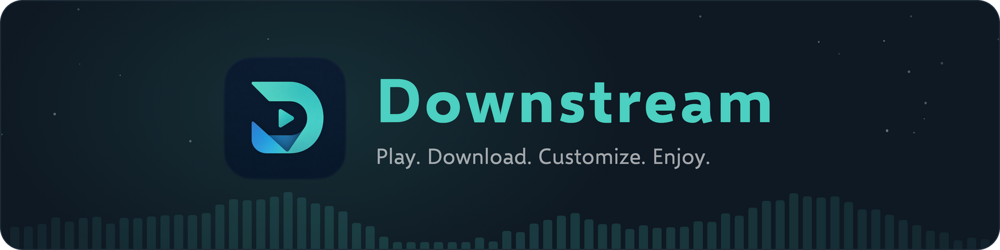
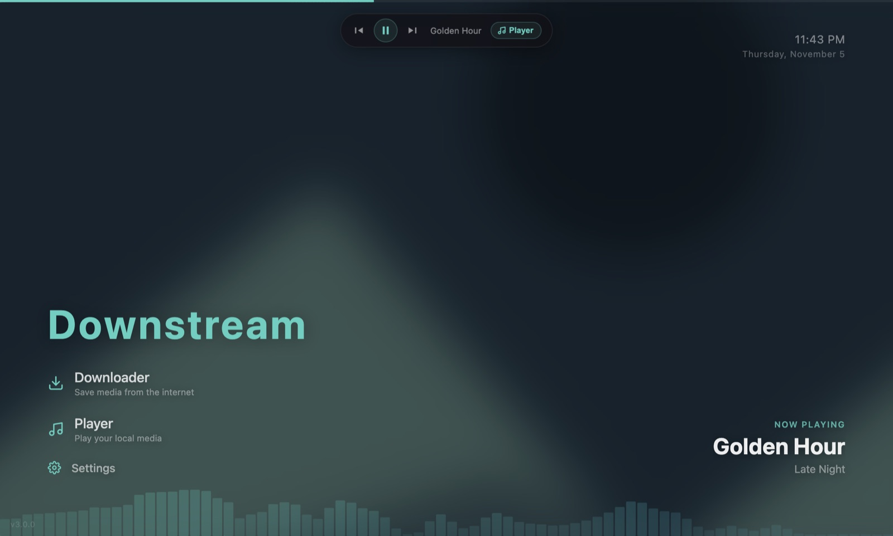
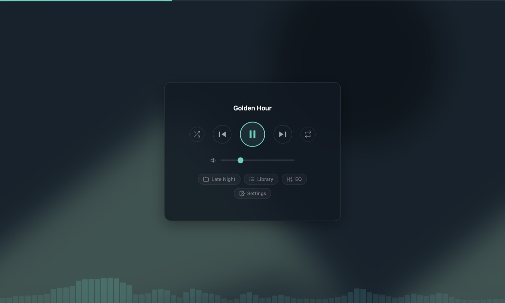

<p align="center">
  
</p>

# Downstream v3.0.0 (Late 2026)
[](https://www.gnu.org/licenses/gpl-3.0)  
**Author:** Stratabytes

## Introduction

**Downstream** is a cross-platform media toolkit built with Electron. It combines a local media player and library with a YouTube downloader, all in one desktop app while being very robust and customizable. It uses libraries like `FFmpeg` and `yt-dlp` for fast and reliable downloads.
> **note:** Downstream is a tool and the app is designed for legal use cases. Please respect copyright laws and platform terms of service when downloading media. You are solely responsible for appropriate usage (;

<p align="center">
  
  
</p>


## Download

Grab the one for your computer! Older versions are all on the [releases page](https://github.com/StrataBytes/Downstream/releases).

| Platform | Download |
|----------|----------|
| **Windows** <sub>10 & 11</sub> | [WIN_Downstream-3.0.0.Setup.exe](https://github.com/StrataBytes/Downstream/releases/download/3.0.0/WIN_Downstream-3.0.0.Setup.exe) |
| **macOS** <sub>Catalina and above</sub> | [MAC_Downstream-3.0.0.dmg](https://github.com/StrataBytes/Downstream/releases/download/3.0.0/MAC_Downstream-3.0.0.dmg) |
| **Legacy macOS** <sub>High Sierra & Mojave</sub> | [MAC-Legacy_Downstream-3.0.0.dmg](https://github.com/StrataBytes/Downstream/releases/download/3.0.0/MAC-Legacy_Downstream-3.0.0.dmg) |
| **Linux** <sub>Ubuntu 26.04</sub> | [LINUX_Downstream-3.0.0.deb](https://github.com/StrataBytes/Downstream/releases/download/3.0.0/LINUX_Downstream-3.0.0.deb) |

On Linux, install it from the folder you downloaded it to with `sudo apt install ./LINUX_Downstream-3.0.0.deb`

### Good to Know...
- Windows 10 & 11 is Downstream's 'native' operating system.
- macOS has been tested and developed quite thoroughly and is considered stable now, particularly on macOS Sequoia.
- Legacy macOS is the same Downstream, just built to run on older Macs and it might trail the regular release by a version.
- Linux is built and tested on Ubuntu 26.04. Older Ubuntu releases back to 22.04 should run it too, they just haven't been tested as heavily.


## Features

#### The Player
- **Your Library**: Folders and mixtapes, with media you can add, move, delete and search without leaving the app.
- **Sounds Right**: A 10-band EQ with presets, and even volume so nothing is suddenly loud or quiet.
- **Looks Good**: Album art and video backgrounds, a visualizer, and three view modes, including Voyager, an ambient starfield. A perfect background player.
- **Plays Nice With Your System**: Media keys and system controls on every platform, plus the Touch Bar on Macs that have one.

#### The Downloader
- **Search or Paste a Link**: Find videos right inside Downstream, including full playlists, radio and unlisted links.
- **MP4 or MP3**: Pick the quality and format for one download, or for the whole queue at once.
- **Save Where You Want**: Your Downloads folder, or straight into a Downstream folder the player picks up.
- **Keeps Working**: Downstream updates yt-dlp in the background, so downloads carry on as YouTube changes.

#### Everywhere
- **Make It Yours**: A full settings window, plus a built-in Guide that shows how everything works.
- **Lite Mode**: Kicks in by itself on older hardware, cutting back blur and effects so everything stays smooth.
- **Update Checks**: The home screen lets you know when a new version is out.


## Building Manually

You'll need [Node.js](https://nodejs.org/) (LTS version recommended) and [Git](https://git-scm.com/). On Linux, you'll also need `fakeroot` to build the `.deb` (`sudo apt install fakeroot`).

1. Clone the repository and navigate to the project directory:
    ```bash
    git clone https://github.com/stratabytes/downstream.git
    cd downstream
    ```

2. Install dependencies:
    ```bash
    npm run setup
    ```
   This installs packages and downloads the required binaries (ffmpeg, yt-dlp, Electron). Use this instead of plain `npm install`.

3. Run the app in development mode:
    ```bash
    npm start
    ```

4. Build the installer with the script for your platform: `build.bat` on Windows, `duild-mac.sh` on macOS (`duild-mac-legacy.sh` for High Sierra & Mojave) or `duild-linux.sh` on Linux. Each installer is built on its own platform, and it lands in `out/make/` (`out-legacy/make/` for legacy macOS).

More on how each platform is set up is in [referenceNotes/PLATFORM.md](referenceNotes/PLATFORM.md).


## Misc. Info

<details>
<summary><b>Why does Downstream seem to skip version numbers?</b></summary>

> Well, whenever I am working on a new build for Downstream which adds features, I tend to slowly build, test and daily drive the new version until all of the glaring issues are worked out. At the end of it all, I've already bumped the version number serveral times before it was even public! 
Patches and hotfixes are usually always insta-pushed as the latest version, as stability is the main goal of Downstream.
</details>

<details>
<summary><b>Stance of patching & hotfixes</b></summary>

> Youtube loves to break apps like these by making goofy changes to their platform! Im not 24/7 working on Downstream, so fixes might be a little slow if its not app-breakingly bad. 
</details>

<details>
<summary><b>Broken downloads due to YT?</b></summary>

> When youtube breaks downloads, this usually takes a while to get fixed, but is high priority. While I might not be right away fixing it, you can probably expect the app to be running on its own again once yt-dlp pushes a new, working version which downstream automatically swaps with - you can also mess around in the advanced settings on the main menu's settings page.  (thanks a ton for the contributors of yt-dlp!)
</details>

<details>
<summary><b>General issues, app bugs and glitches?</b></summary>

> Because this is a passion project, most minor issues will not be quickly resolved. Only high severity problems will be patched with relative haste.
> Additionally, cutting-edge hardware or OS changes are not included in stability priority. I dont plan on buying a new mac every 3 years, or upgrading to windows 12 right away.
</details>

### Other Attributions
> Thanks to @davidhurtado2000 for lending a hand on the v1 downloader prototype.

> Generative Content: Downstream's current logo was built using OpenAI tools.

## License

This project is licensed under the **GPLv3**. See the [LICENSE](LICENSE) file for more details.
